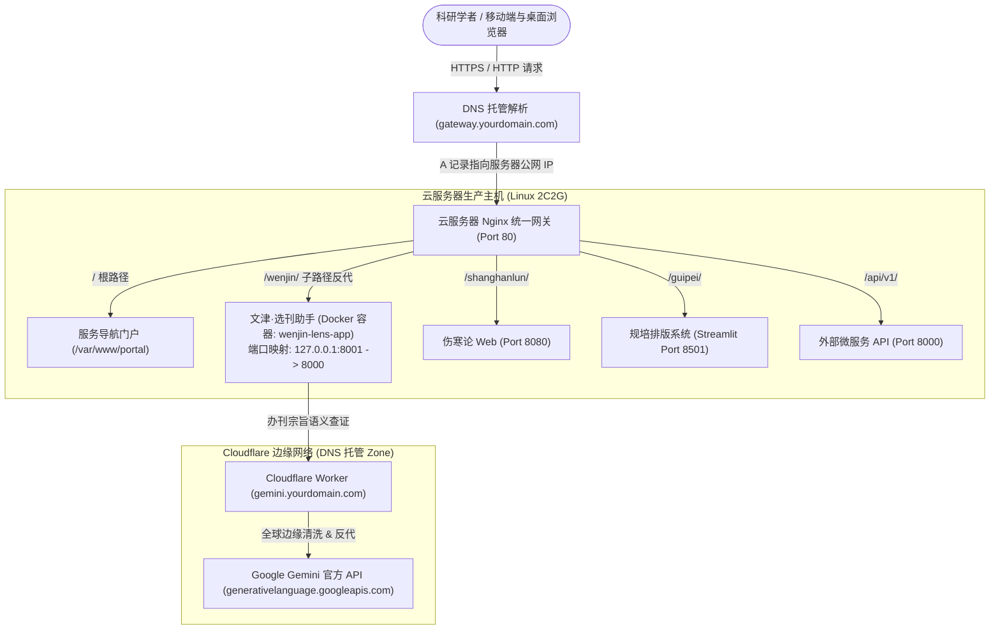

# 文津·选刊助手 (Wenjin-Lens) 生产环境部署与运维手册 (DEPLOYMENT.md)

本文档面向系统管理员、DevOps 工程师及科研团队技术负责人，提供在生产服务器（Linux / Docker / Windows Server）上部署与长期稳定运行 **文津·选刊助手 (Wenjin-Lens)** 的完整操作指南。

---

## 目录

1. [系统架构与运行环境要求](#一系统架构与运行环境要求)
2. [方式一：Docker / Docker Compose 容器化部署（强烈推荐）](#二方式一docker--docker-compose-容器化部署强烈推荐)
3. [方式二：Linux 原生环境部署（Systemd + Uvicorn + Nginx）](#三方式二linux-原生环境部署systemd--uvicorn--nginx)
4. [方式三：Windows / 局域网轻量部署](#四方式三windows--局域网轻量部署)
5. [生产安全加固与密钥物理隔离清单](#五生产安全加固与密钥物理隔离清单)
6. [数据持久化、备份与灾难恢复](#六数据持久化备份与灾难恢复)
7. [健康检查与运维监控](#七健康检查与运维监控)
8. [云端部署与全浏览器兼容保障](#八云端部署与全浏览器兼容保障-cross-browser--offline-reliability)
9. [阿里云 ECS 生产环境实战：多服务网关与 Cloudflare 域名托管架构](#九阿里云-ecs-生产环境实战多服务网关与-cloudflare-域名托管架构)

---

## 一、系统架构与运行环境要求

### 1. 技术栈概览
- **后端框架**：Python 3.10+ / FastAPI / Uvicorn (ASGI 异步高并发驱动)
- **数据存储**：SQLite (`cas_jcr.db`) + 扁平 JSON 知识库 + OpenPyXL (.xlsx 决策台账)
- **外部生态**：OpenAlex API + DOAJ API (零认证免Key) + Google AI Studio (Gemini 语义核验)
- **前端架构**：Vue 3 + Element Plus + Chart.js（宣纸温润白 / 深墨雅夜双学术主题）

### 2. 服务器最低硬件配置
- **CPU**：1 核心或以上 (推荐 2 核心)
- **内存**：1 GB RAM 或以上 (推荐 2 GB，便于 SQLite 缓存及并发请求)
- **磁盘存储**：空闲空间 $\ge$ 500 MB (主程序及底层学术索引库约占 25 MB)
- **操作系统**：Ubuntu 20.04/22.04 LTS、Debian 11/12、CentOS 8/Rocky Linux、Windows Server 2019+

---

## 二、方式一：Docker / Docker Compose 容器化部署（强烈推荐）

容器化部署可确保环境完全隔离，一键编排并支持故障自动重启与持久化挂载。

### 1. 准备配置文件
在项目根目录下复制环境变量模板：
```bash
cp .env.example .env
```
根据实际需求修改 `.env`（如不需要配置 Gemini API Key，可直接留空）：
```ini
HOST=0.0.0.0
PORT=8000
WORKERS=2
GEMINI_API_KEY=your_gemini_api_key_here
```

### 2. 一键构建并启动容器
```bash
# 构建镜像并后台启动
docker compose up -d --build

# 查看运行状态
docker compose ps

# 查看实时运行日志
docker compose logs -f
```

### 3. 数据挂载说明
`docker-compose.yml` 已配置自动持久化卷：
- `./data/track` $\rightarrow$ `/app/data/track`：用户的选刊历史 Excel 台账
- `./config` $\rightarrow$ `/app/config`：本地配置文件

---

## 三、方式二：Linux 原生环境部署（Systemd + Uvicorn + Nginx）

适用于需要结合校园网 / 机构服务器现有反向代理体系的场景。

### 1. 检出代码并创建专用虚拟环境
```bash
# 创建部署目录
sudo mkdir -p /var/www/Wenjin-Lens
sudo chown -R $USER:$USER /var/www/Wenjin-Lens

# 进入目录并克隆/拷贝项目
cd /var/www/Wenjin-Lens

# 创建 Python 3 虚拟环境
python3 -m venv venv
source venv/bin/activate

# 安装生产依赖
pip install --upgrade pip
pip install -r requirements.txt
```

### 2. 配置 Systemd 守护进程
将项目中的服务配置文件拷贝至系统服务目录：
```bash
sudo cp deploy/wenjin-lens.service /etc/systemd/system/
```
编辑 `/etc/systemd/system/wenjin-lens.service` 确认路径及运行用户：
```ini
[Unit]
Description=Wenjin-Lens Academic Journal Selector
After=network.target

[Service]
Type=simple
User=www-data
Group=www-data
WorkingDirectory=/var/www/Wenjin-Lens
EnvironmentFile=-/var/www/Wenjin-Lens/.env
ExecStart=/var/www/Wenjin-Lens/venv/bin/python web_app.py --host 127.0.0.1 --port 8000 --workers 2
Restart=always
RestartSec=5s

[Install]
WantedBy=multi-user.target
```
启动并启用开机自启：
```bash
# 重载守护进程
sudo systemctl daemon-reload

# 启动服务并设置自启
sudo systemctl start wenjin-lens
sudo systemctl enable wenjin-lens

# 查看服务状态
sudo systemctl status wenjin-lens
```

### 3. 配置 Nginx 反向代理与 SSL
将 `deploy/nginx.conf` 复制到 Nginx 配置目录：
```bash
sudo cp deploy/nginx.conf /etc/nginx/sites-available/wenjin-lens.conf
sudo ln -s /etc/nginx/sites-available/wenjin-lens.conf /etc/nginx/sites-enabled/

# 测试 Nginx 语法并平滑重载
sudo nginx -t
sudo systemctl reload nginx
```

---

## 四、方式三：Windows / 局域网轻量部署

针对实验室、教研室局域网内工作站或个人工作站部署：

1. **双击运行**：直接双击项目根目录下的 `start_web.bat`。
2. **局域网共享访问**：
   在命令行指定 `--host 0.0.0.0`：
   ```cmd
   python web_app.py --host 0.0.0.0 --port 8000
   ```
   实验室同网段成员通过浏览器访问 `http://<服务器内网IP>:8000` 即可协同选刊。

---

## 五、生产安全加固与密钥物理隔离清单

在将系统投入开放网络运行前，请逐项核对以下安全红线：

| 检查项 | 规约要求 | 达标检验方式 |
| :--- | :--- | :--- |
| **API 密钥隔离** | 严禁将任何明文 Key 写入仓库或公开发布 | 确认 `.gitignore` 包含 `config/config.json` 与 `.env`；仅通过环境变量传递 |
| **决策台账隐私** | 避免研究人员个人投稿历史泄露 | 确认 `data/track/journal_track.*` 已被 `.gitignore` 严格忽略 |
| **接口超时防护** | 避免外部学术 API 阻塞造成线程耗尽 | `academic_api.py` 与 `ai_verifier.py` 已内置 12~35s 超时断路 |
| **CORS 跨域策略** | 生产多域名部署按需收紧 | 在 `app/web/api.py` 中将 `allow_origins=["*"]` 替换为实际高校或组织域名 |
| **敏感路径隐藏** | 防止暴露服务器系统文件与源码 | Nginx 配置中已包含 `location ~ /\. { deny all; }` |

---

## 六、数据持久化、备份与灾难恢复

系统的数据资产集中在 `data/` 目录：
1. **基础只读目录**（`data/catalog/`）：包含广中医 308 号文件、CSCD、中科院历史镜像 `cas_jcr.db` 等静态大库，日常由版本库维护。
2. **动态知识库**（`data/kb/journal_kb.json`）：保存联网核验沉淀的期刊元数据。
3. **选刊决策台账**（`data/track/journal_track.xlsx`）：研究者的选刊记录。

### 定时备份脚本推荐 (Linux Crontab)
```bash
# 每天凌晨 3:00 自动备份动态知识库与台账
0 3 * * * tar -czf /backup/wenjin-lens-$(date +\%F).tar.gz /var/www/Wenjin-Lens/data/track /var/www/Wenjin-Lens/data/kb
```

---

## 七、健康检查与运维监控

系统提供了标准的轻量级微内核探针接口：

- **探针 URL**：`GET /api/health`
- **正常响应**：
  ```json
  {
    "status": "ok",
    "app": "Wenjin-Lens",
    "version": "2.2.0"
  }
  ```
- **系统运行全景指标**：`GET /api/stats`
  可获取当前系统加载的官方目录数、全国中文核心数、预警期刊数、已核验知识条目数以及累计追踪数。

---

## 八、云端部署与全浏览器兼容保障 (Cross-Browser & Offline Reliability)

为彻底解决“上云后部分浏览器无法打开或移动端排版溢出”的痛点，系统已全面固化以下架构规范：

### 1. 全量静态依赖本地化托管（Zero-CDN 架构）
- **痛点规避**：彻底移除对境外公共 CDN（`cdnjs.cloudflare.com`、`cdn.jsdelivr.net`）及 Google Fonts 的强依赖，避免国内移动宽带、校园网 DNS 污染或限速造成的 `Vue is not defined` 致命白屏。
- **文件存储**：全套运行时（Vue 3、Element Plus、Chart.js 等）统一内置于 `app/web/static/libs/`，总开销仅 1.75 MB（Gzip 后网络传输不足 480 KB），开箱即用。

### 2. 国产双核浏览器极速核心加固
- `index.html` 头部强制声明 `<meta name="renderer" content="webkit">` 与 `<meta http-equiv="X-UA-Compatible" content="IE=edge,chrome=1">`；
- 360安全浏览器、360极速浏览器、QQ 浏览器、搜狗高速浏览器通过云服务器 IP 访问时，自动激活 WebKit/Blink 极速核心，杜绝误入 IE 模式。

### 3. 移动端防爆框与超宽表格内联隔离
- 顶栏胶囊导航在移动小屏下自动切换为无滚动条平滑滑行；
- 官方目录及台账中超过 1100px 的多维宽表格在移动端采用独立内联触摸滚动隔离，绝对不撑爆根视口，杜绝手机端横向晃动或右半屏截断现象。

---

## 九、云端生产环境实战：多服务网关与 Cloudflare 域名托管架构

本节专门记录云服务器生产环境（基于域名托管与多服务统一网关）的现网运行拓扑、DNS 域名托管、Nginx 网关路由及 Gemini API 免翻反代实践。

### 1. 现网拓扑架构全景 (Production Topology)

在云服务器上，系统推荐采用“**宿主机 Nginx 统一网关 + Docker 容器微服务化 + Cloudflare 边缘反向代理**”的高可用架构：



### 2. 多服务端口规划与隔离规范

为确保多系统共存时互不干扰，宿主机端口规划如下：

| 业务系统 | 容器 / 进程端口 | 宿主机映射端口 | Nginx 网关访问路径 | 说明 |
| :--- | :--- | :--- | :--- | :--- |
| **文津·选刊助手** | `8000/tcp` | `127.0.0.1:8001` | `/wenjin/` 或独立域名 | 本项目，避开 8000 默认端口冲突 |
| **多系统门户主页** | 静态页面 | - | `/` (根路径) | 挂载在 `/var/www/portal/index.html` |
| **伤寒论 Web** | `8080/tcp` | `127.0.0.1:8080` | `/shanghanlun/` | 中医药古籍智能检索 |
| **规培排版系统** | `8501/tcp` | `127.0.0.1:8501` | `/guipei/` | 基于 Streamlit 支持 WebSocket |
| **外部微服务 API** | `8000/tcp` | `127.0.0.1:8000` | `/api/v1/` | 后端辅助数据接口 |

### 3. Nginx 网关子路径挂载与 URI 剥离机制

在 `/etc/nginx/sites-available/default` 中，文津选刊助手的核心反向代理规则如下：

```nginx
# 文津·选刊助手反向代理
location /wenjin/ {
    # 核心要点：proxy_pass 末尾带有斜杠 "/"
    # 当请求访问 /wenjin/api/catalog/query 时，Nginx 会自动剥离 "/wenjin/" 前缀，
    # 将规范的 /api/catalog/query 请求转发给容器 8001 端口的 FastAPI 后端。
    proxy_pass http://127.0.0.1:8001/;
    proxy_http_version 1.1;

    # 传递 WebSocket / SSE 升级协议
    proxy_set_header Upgrade $http_upgrade;
    proxy_set_header Connection "upgrade";

    # 透传真实客户端网络元数据
    proxy_set_header Host $host;
    proxy_set_header X-Real-IP $remote_addr;
    proxy_set_header X-Forwarded-For $proxy_add_x_forwarded_for;
    proxy_set_header X-Forwarded-Proto $scheme;

    # AI 深度查证长连接防超时中断
    proxy_connect_timeout 60s;
    proxy_read_timeout 60s;
    proxy_send_timeout 60s;
}
```

#### 前端自动适配机制
前端客户端（`app/web/static/js/services/api.js`）已内置环境自适应逻辑：
- 当用户通过网关二级路径（如 `http://gateway.yourdomain.com/wenjin/`）访问时，检测到 `pathname.startsWith('/wenjin')`，API 请求会自动前缀 `/wenjin`；
- 当用户通过独立二级域名（如 `http://wenjin.yourdomain.com/`）或本地 `http://localhost:8000/` 访问时，基础路径保持为空，完全向下兼容。

### 4. Cloudflare Worker + 自定义域名免翻墙反代 Gemini API

由于国内云服务器访问 Google API 受限，本项目配套提供了 Cloudflare Worker 免翻代理解析方案（位于 `cloudflare-worker/` 目录）：

1. **托管拓扑**：
   - Cloudflare Zone：`yourdomain.com`
   - Worker 项目名：`wenjin-gemini-proxy`
   - 生产绑定域名：`https://gemini.yourdomain.com`
2. **反向代理逻辑**：
   - 接收云端发往 `https://gemini.yourdomain.com/v1beta/...` 的 HTTP 请求；
   - 自动重写 Host 为 `generativelanguage.googleapis.com:443`；
   - 补齐 CORS 响应头并由 Google 官方返回结果；
   - 彻底摆脱在服务器端安装配置任何本地代理客户端的沉重依赖。
3. **环境激活**：
   只需在生产环境 `.env` 中指定：
   ```ini
   GEMINI_API_KEY=your_gemini_api_key
   GEMINI_BASE_URL=https://gemini.yourdomain.com
   ```
   项目在进行期刊办刊宗旨深度语义查证时，将自动通过该高可用节点安全通信。

### 5. 云端服务一键维护与滚动更新

若本地代码完成迭代（如性能调优或界面增强），可通过以下步骤平滑同步至云服务器：

```bash
# 1. 登录云服务器
ssh your_server_user@your_server_ip

# 2. 进入项目部署根目录
cd /opt/wenjin-lens

# 3. 检查容器状态
docker compose ps

# 4. 重新构建并平滑重启容器
docker compose up -d --build

# 5. 查看健康探针返回
curl -s http://127.0.0.1:8001/api/health
# 预期返回: {"status":"ok","app":"Wenjin-Lens","version":"2.2.0"}
```


