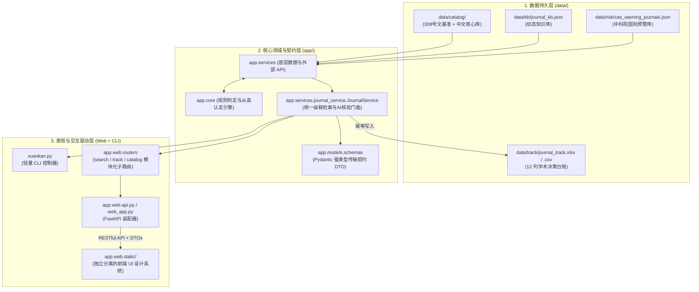

# 选刊助手（Wenjin-Lens）后续开发与维护规范指南（DEVELOPMENT.md）

本文档作为选刊助手（`xuankan` / `Wenjin-Lens`）的核心工程开发技术白皮书，旨在为后续代码迭代、数据扩充以及 Google AI Studio 配置提供标准化、无歧义的支撑依据。

---

## 一、 系统架构与版本迭代演进模型

系统历经从轻量终端单机工具到企业级微内核前后端解耦平台的演进，现采用“**强类型契约层 + 统一领域门面 + 模块化子路由 + 独立前端 UI 设计系统**”的高内聚解耦架构：



### 版本迭代演进轨迹 (Architecture Evolution Log)

1. **v1.0 (基准奠定·单机离线检索)**：
   - 解析并固化广州中医药大学校办〔2020〕308号官方目录（134 种 B 类刊物与定级规则）。
   - 命令行终端输出 9 项选刊核心指标，自动沉淀至 12 列标准 Excel 决策追踪表。
2. **v1.5 / v2.0 (双模驱动·开放学术生态与 AI 联网深度查证)**：
   - 免 Key 免注册对接 OpenAlex 与 DOAJ 开放学术 API，获取权威主页、OA 模式与官方 APC，杜绝大模型数值幻觉。
   - 接入 Google AI Studio (Gemini) 进行办刊语义提炼。
   - 建立中国科学院文献情报中心《国际期刊预警名单》离线比对引擎，毫秒级阻断学术治理风险。
   - 扩充全国中文核心与 CSCD 核心库，覆盖 27 种高被引中医药名刊。
3. **v2.1 (工作台化·FastAPI 异步微内核与现代学术 Web 界面)**：
   - 引入 FastAPI 驱动的高性能本地 Web 服务。
   - 践行 `DESIGN.md` 与 `academic-ui-craft` 规范，打造宣纸温润白与深墨雅夜双色调界面。
   - 提供可视化检索、多维智能筛选、决策台账管理与 3 刊横向对比矩阵。
4. **v2.2 (企业级工程化·全模块化设计、UI 独立分离与标准接口通信)**：
   - **后端解耦**：抽象 `JournalService` 统一领域门面，消除 Web 与 CLI 重复判定代码；定义 Pydantic DTO 契约；拆分为独立子路由。
   - **前端独立分离**：`index.html` 剥离全部内嵌脚本；拆解为 `tokens.css`、`layout.css`、`components.css`；封装 `WenjinAPI` 单例，全流程通过接口传输数据。

### 数据流生命周期规约
1. **不可变基准**：`data/catalog/journal_catalog.json` 严格源自广中医 308 号文，除学校政策更新外，**禁止在运行期写入或动态修改**。
2. **增量知识库**：`data/kb/journal_kb.json` 采用以期刊名称（`name`）为唯一主键的字典结构。仅在对新刊核验成功后追加或刷新，未核验字段均显式标记为 `null`、`false` 或 `待核验`。
3. **幂等追踪表**：`data/track/journal_track.xlsx` 每次执行查询时，按期刊名称进行 upsert（更新已有行，或在末尾追加新行），无论查询多少次均保持记录唯一。
4. **双端平权共享**：CLI 命令行与 Web 网页端全量共享 `JournalService` 统一领域门面，所有通过 Web 检索的记录同样会自动归档至追踪表。

---

## 二、 `xuankan.py` 代码迭代改造规范

为了在后续开发中将 `xuankan.py` 内部逻辑与 `README.md` 的 **9 项核心输出** 及 **12 列追踪表** 彻底对齐，需按照以下代码级改造规约执行：

### 1. 表头与映射改造（`TRACK_HEADERS`）
当前代码中的旧表头与 `README.md` 中定义的 A~L 12 列映射如下，需在迭代时完成字段对齐：

```python
# 目标追踪表 12 列表头（A ~ L 列）
TRACK_HEADERS = [
    "期刊名称",              # A: 官方全称（主键）
    "ISSN / CN",            # B: 刊号（如 ISSN 1673-1727 | CN 11-5334/R）
    "收录索引",              # C: CSCD/北大核心/SCIE等
    "广中医认定级别",        # D: A类1级~4级 / B类 / 不符合
    "影响因子(JIF)",         # E: 影响因子数值及口径说明
    "中科院分区",            # F: 中科院大类及小类学科分区
    "主编信息",              # G: 主编姓名及机构
    "收稿方向",              # H: 办刊宗旨、重点栏目与篇幅要求
    "审稿周期",              # I: 官方承诺时限与作者经验
    "出版方式与版面费",      # J: OA/订阅、出版周期、APC收费标准
    "投稿方式",              # K: 官方采编网址与防伪避坑提示
    "核验日期与来源"         # L: 核验日期 + 来源链接数
]
```

### 2. 行记录组装改造（`build_track_row`）
需在 `build_track_row()` 中补充 `ISSN / CN`、`出版方式与版面费`、`投稿方式` 的拼装逻辑，并实现旧数据兼容：

```python
def build_track_row(journal_rec, kb_rec, catalog, best_level, kb_only=False):
    kb = kb_rec or {}
    basic = kb.get("basic") or {}
    if_ = kb.get("impact_factor") or {}
    editor = kb.get("editor_in_chief") or {}
    idx = kb.get("indexes") or {}
    verified = bool(idx.get("indexes_verified"))

    name = journal_rec["name"]
    level = LEVEL_LABEL.get(best_level, best_level) if best_level else "不符合/待核验"

    # 刊号组装 (B列)
    issn_cn = []
    issn_val = journal_rec.get("issn") or basic.get("issn")
    cn_val = journal_rec.get("cn") or basic.get("cn")
    if issn_val: issn_cn.append(f"ISSN {issn_val}")
    if cn_val: issn_cn.append(f"CN {cn_val}")
    issn_cn_str = " | ".join(issn_cn) if issn_cn else "待核验"

    # 出版方式与版面费组装 (J列)
    pub_mode = kb.get("publication_mode") or ""
    apc = kb.get("apc_fee") or ""
    pub_apc_str = f"{pub_mode}；版面费: {apc}" if (pub_mode or apc) else ("待核验" if not verified else "未获取")

    # 投稿方式组装 (K列)
    sub_url = kb.get("submission_url") or ("待核验" if not verified else "无官方系统说明")

    # 核验日期与来源数 (L列)
    sources = kb.get("sources") or []
    updated_str = kb.get("updated") or ("已核验" if verified else "未核验")
    verify_str = f"{updated_str}（{len(sources)}个来源）" if sources else updated_str

    return {
        "期刊名称": name,
        "ISSN / CN": issn_cn_str,
        "收录索引": index_summary(kb_rec),
        "广中医认定级别": level,
        "影响因子(JIF)": (if_.get("jcr_if") or "") if verified and if_ else "待核验",
        "中科院分区": (if_.get("cas_zone") or "") if verified and if_ else "待核验",
        "主编信息": (editor.get("name") or "") if verified and editor else "待核验",
        "收稿方向": (kb.get("scope") or "") if verified and kb.get("scope") else "待核验",
        "审稿周期": (kb.get("review_cycle") or "") if verified and kb.get("review_cycle") else "待核验",
        "出版方式与版面费": pub_apc_str,
        "投稿方式": sub_url,
        "核验日期与来源": verify_str,
    }
```

### 3. 终端 9 项完整可视化打印（`journal_display`）
在 `journal_display()` 中扩充 `[7]`、`[8]`、`[9]` 项输出，与 README 严格对齐：

```python
    # [7] 出版方式
    pub_mode = kb.get("publication_mode")
    lines.append(f"[7] 出版方式：{pub_mode if pub_mode else '知识库暂无，待检索核验'}")

    # [8] 版面费（APC）
    apc = kb.get("apc_fee")
    lines.append(f"[8] 版面费：{apc if apc else '知识库暂无，待检索核验'}")

    # [9] 投稿方式与防伪提示
    sub = kb.get("submission_url")
    lines.append(f"[9] 投稿方式：{sub if sub else '知识库暂无，待检索核验'}")
```

### 4. Excel 列宽与样式优化（`save_track`）
在 `save_track()` 中，对应更新 12 列自适应列宽字典：
```python
widths = {
    "A": 36,  # 期刊名称
    "B": 24,  # ISSN / CN
    "C": 42,  # 收录索引
    "D": 16,  # 广中医认定级别
    "E": 18,  # 影响因子(JIF)
    "F": 22,  # 中科院分区
    "G": 28,  # 主编信息
    "H": 50,  # 收稿方向
    "I": 42,  # 审稿周期
    "J": 30,  # 出版方式与版面费
    "K": 36,  # 投稿方式
    "L": 20,  # 核验日期与来源
}
```

---

## 三、 Google AI Studio 生产级配置与 Prompt 模板

后续开发者在 Google AI Studio 界面创建专属核验应用时，可直接照搬以下配置：

### 1. Model & Tools 选择
- **Model**：`Gemini 1.5 Pro` 或 `Gemini 2.5 Flash`
- **System Tools**：勾选开启 **Grounding with Google Search**
- **Response Format**：选择 **Structured Output (JSON)**，并填入 `README.md` 中的 `JournalKBRecord` Schema。

### 2. System Instructions (完整系统提示词)

```text
你是一名严谨的中国中医药学与生物医学高校科研选刊专家，负责为“广州中医药大学”教师与科研人员核验目标期刊的选刊指标。

【权威依据】
你的期刊级别判定必须严格基于《广州中医药大学重要期刊目录（试行）》（广中医校办〔2020〕308号）官方文件：
1. A类1级：求是（1500字左右理论文章）、科学通报、中国社会科学、SCIE中科院1区、SSCI 1区。
2. A类2级：CSCD核心版、CSSCI核心版、A&HCI、SCIE 2区、SSCI 2区、新华文摘全文转载。
3. A类3级：中文核心期刊要目总览（北大核心）、中国人文社会科学核心期刊要览、CSSCI扩展版、SCIE 3区、SSCI 3区、人民日报/光明日报理论版全文转载、解放军报（1500字以上理论文章）。
4. A类4级：CSCD扩展版、SCIE 4区、SSCI 4区、EI Compendex（工程索引核心版）期刊（不含会议论文）、经济日报（1500字以上理论文章）、人大复印报刊资料全文转载（3000字以上，不含“文摘”系列、“报刊资料索引”系列及中心原发刊）、南方日报理论版。
5. 关键原则：
   - 就高认定：目录内刊物如进入更高级别，按高级别认定（如B类刊物进入CSCD核心版升级为A2）。
   - 兜底原则：若因特殊原因未提供分区，以可查年限中最近年份分区为准。
   - 本校限制：《新中医》《广州中医药大学学报》《中医肿瘤学杂志》每人每次职称申报仅可用1篇。

【联网检索与防伪原则（必须调用 Google Search）】
1. 必须检索期刊最新官方主页、万方/知网/LetPub/Web of Science 权威页面核实最新信息。
2. 严厉防范钓鱼与山寨期刊网：对于投稿方式，必须提供官方采编系统链接（若有独立官方域名），并明确标注“防伪提示”。
3. 版面费（APC）：必须明确说明是否为OA、是否有版面费、收费标准及币种。
4. 严格输出符合预设 Schema 的 JSON 数据，不得输出任何前导或后置客套话。
```

### 3. 一键同步回写工作流
在 Google AI Studio 界面得到结构化 JSON 后，无需手工繁琐修改文件，后续开发可配套编写轻量同步函数或直接执行：
```bash
# 示例：通过本地辅助函数直接把 AI Studio 返回的标准 JSON 追加/合并到 journal_kb.json
python3 xuankan.py --import-json "response.json"
```

---

## 四、 回归测试用例集（Test Case Matrix）

后续任何代码修改或规则变更，均需通过以下 6 个基准测试用例验证，确保结果一致性：

| 编号 | 测试期刊 / 关键词 | 测试目的与关键边界 | 期望认定级别 | 关键验证点 |
|:---:|---|---|:---:|---|
| **TC-01** | `中华中医药杂志` | 目录内 B 类期刊按 CSCD 核心版升级 | **A类2级** | 必须触发“按目录备注1升级认定”提示；验证 JCR IF / 维普 IF 说明 |
| **TC-02** | `广州中医药大学学报` | 目录内本单位限制期刊 | **B类** | 必须触发“【目录备注4】每人每次职称申报仅可用1篇”警告 |
| **TC-03** | `Scientific Reports` | 目录外知名开源综合 SCI | **A类3级** | 必须判定为中科院 3 区对应的 A3；正确识别 OA 出版与 APC 费用 |
| **TC-04** | `1673-1727` | ISSN 精确查询 | **A类2级** | 必须能准确反查出《中华中医药杂志》并进入完整选刊输出流程 |
| **TC-05** | `11-5334/R` | 国内统一刊号 CN 精确查询 | **A类2级** | 验证国内期刊及报纸仅提供 CN 时的正确命中 |
| **TC-06** | `北大核心` / `SCIE 1区` | 纯规则语法速查 | 对应级别 | 快速输出 A3 / A1 规则依据，**且不污染追踪表** |

---

## 五、 开发备忘与避坑指南

1. **Windows 编码防御**：
   - 所有读写 CSV/JSON/TXT 的操作必须显式指定 `encoding="utf-8"`（CSV 导出使用 `utf-8-sig`，防止 Excel 打开中文出现乱码）。
2. **免依赖兜底**：
   - 核心代码禁止引入第三方非标库；`openpyxl` 必须保留在 `try...except ImportError` 块内，当用户环境缺少 `openpyxl` 时平滑降级至 CSV 写入，绝不可 crash。
3. **数据一致性保护**：
   - `upsert_track()` 时必须先比对已存在的期刊记录，避免在 `journal_track.xlsx` 中生成重复行。

---

## 六、 模块化解耦架构与接口传输规范 (Modular v2.2)

系统已完成全面的模块化架构重塑，彻底分离核心领域服务、RESTful 路由层、数据契约模型与前端 UI 交互设计系统：

### 1. 后端领域模块化与契约解耦

- **数据契约层 (`app/models/schemas.py`)**：
  - 定义了标准的 Pydantic DTO 模型（`SearchResponseDTO`, `RefreshResponseDTO`, `TrackResponseDTO`, `CatalogResponseDTO`, `StatsResponseDTO`, `WarningInfoDTO`, `LevelInfoDTO`），杜绝散落裸字典传递，实现各模块间强类型约束。
- **统一领域门面服务 (`app/services/journal_service.py`)**：
  - 将原本分散在 Web API 路由与 CLI 中的级联检索算法（目录 -> 中文核心/CSCD -> 知识库 -> 索引规则 -> 相似候选）和 AI 联网核验流程抽象为 `JournalService` 统一门面。
  - Web 路由器与 CLI 终端均作为控制器直接调用 `JournalService.search()` 与 `JournalService.refresh()`。
- **模块化路由器 (`app/web/routers/`)**：
  - `search_router.py`：专注选刊综合检索与 AI 联网深度核验。
  - `track_router.py`：专注决策台账读取、多维条件筛选及 Excel 导出。
  - `catalog_router.py`：专注官方分级目录、系统资产统计与健康探针。
  - `api.py`：瘦身为纯粹的 FastAPI 装配器，负责挂载子路由与静态托管。

### 2. 前端页面 UI 设计独立分离与接口数据传输

前端彻底告别传统单文件大脚本混杂的痛点，将视觉样式、数据接口传输、工具逻辑与视图模板严格分离：

```
app/web/static/
├── index.html                  # 纯净解耦的 HTML 模板与语义视图结构（无内联大段脚本与业务逻辑）
├── css/
│   ├── tokens.css              # 学术设计系统 Design Tokens（宣纸温润白、墨青主色、珊瑚陶土警示、明暗主题变量）
│   ├── layout.css              # 布局系统（1140px 学术黄金阅读宽度、响应式网格、Header、Footer）
│   ├── components.css          # UI 组件库（标签胶囊、9维指标卡片、统计胶囊条、预警提示框、表格、横向对比矩阵）
│   └── academic-theme.css      # 统一主题聚合文件（遵循 DESIGN.md 与 academic-ui-craft 规范）
└── js/
    ├── services/
    │   └── api.js              # 数据接口通信服务（WenjinAPI：封装所有与后端 RESTful API 的接口传输与错误处理）
    ├── modules/
    │   ├── theme.js            # 主题切换模块（明暗模式、状态持久化、微动效响应）
    │   ├── formatters.js       # 数据格式化与工具模块（刊号解析、评级标签计算、简报生成、剪贴板复制）
    │   ├── chart.js            # 学术统计图表模块（Chart.js 甜甜圈图表封装、明暗自适应重绘）
    │   └── comparison.js       # 多维横向对比管理模块（对比列表管理、最大容量约束、数据持久化）
    └── app.js                  # 前端核心业务装配器（Vue 3 应用实例、状态协调、路由切换、各子模块驱动）
```

- **数据接口传输规范**：
  - 前端各 UI 视图组件与操作**严禁**直接内联调用 `fetch()`。
  - 全部数据交换必须经由 `WenjinAPI` (`app/web/static/js/services/api.js`) 进行标准 Promise 异步传输与统一异常拦截。

